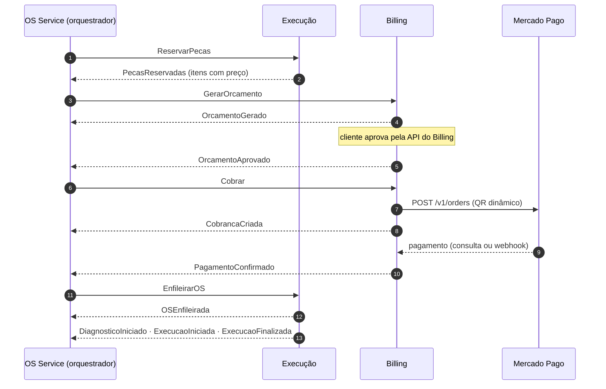

# Contrato de mensagens da Saga

Fonte da verdade: [`asyncapi.yaml`](asyncapi.yaml) (AsyncAPI 3.0). Este texto resume o mesmo contrato
para leitura. Quando os dois divergirem, vale o `asyncapi.yaml`.

Validação: `npx @asyncapi/cli validate docs/contratos/asyncapi.yaml`.

## Topologia no RabbitMQ

| Exchange | Tipo | Quem publica | Para quê |
|---|---|---|---|
| `oficina.comandos` | topic | OS Service | Pedidos do orquestrador aos participantes |
| `oficina.eventos` | topic | Execução e Billing | Resultado dos comandos e mudanças de estado |
| `oficina.dlx` | topic | RabbitMQ | Destino das mensagens que esgotaram as tentativas |

| Fila | Ligada a | Chave | Consumidor |
|---|---|---|---|
| `execucao-service.comandos` | `oficina.comandos` | `execucao.#` | Execução |
| `billing-service.comandos` | `oficina.comandos` | `billing.#` | Billing |
| `os-service.eventos` | `oficina.eventos` | `execucao.#` e `billing.#` | OS Service |
| `<fila>.dlq` | `oficina.dlx` | nome da fila de origem | ninguém (alerta e inspeção) |

- As filas são **quorum queues** com `x-delivery-limit: 5`: depois de seis entregas sem `ack` (a
  primeira e cinco reentregas), a mensagem vai para a DLQ da fila (`x-dead-letter-exchange: oficina.dlx`, `x-dead-letter-routing-key: <fila>`).
- Cada serviço declara as exchanges em que publica e as filas que consome ao iniciar. A declaração é
  idempotente, então a ordem de subida não importa.
- A chave de roteamento é `<serviço de destino ou de origem>.<mensagem em kebab-case>`, por exemplo
  `execucao.reservar-pecas` e `billing.pagamento-confirmado`.

## Envelope

Toda mensagem tem o mesmo corpo JSON:

```json
{
  "message_id": "0d6f3c1e-…",
  "tipo": "ReservarPecas",
  "versao": 1,
  "saga_id": "7a1b…",
  "os_id": "c93e…",
  "ocorrido_em": "2026-11-12T15:00:00Z",
  "origem": "os-service",
  "payload": { "itens": [ { "tipo": "PECA", "item_id": "…", "quantidade": 2 } ] }
}
```

| Propriedade AMQP | Valor |
|---|---|
| `message_id` | igual ao `message_id` do corpo |
| `type` | igual ao `tipo` |
| `correlation_id` | `saga_id` |
| `content_type` | `application/json` |
| `delivery_mode` | 2 (persistente) |
| cabeçalhos | `traceparent`, `tracestate` e `newrelic`, para o rastreamento distribuído |

Dinheiro trafega como texto com duas casas (`"150.00"`). Datas em RFC 3339, UTC. CPF/CNPJ não trafega:
o Billing confere o titular pelo `cliente_id` do JWT.

## A Saga, passo a passo



| Passo da Saga | Comando enviado | Sucesso | Falha | Status da OS ao concluir o passo |
|---|---|---|---|---|
| `RESERVANDO_PECAS` | `ReservarPecas` | `PecasReservadas` | `ReservaRecusada` | inalterado (`ABERTA`) |
| `GERANDO_ORCAMENTO` | `GerarOrcamento` | `OrcamentoGerado` | — | `AGUARDANDO_APROVACAO` |
| `AGUARDANDO_APROVACAO` | — | `OrcamentoAprovado` | `OrcamentoRejeitado` | `AGUARDANDO_PAGAMENTO` |
| `AGUARDANDO_PAGAMENTO` | `Cobrar` | `PagamentoConfirmado` | `PagamentoRecusado` | inalterado (`AGUARDANDO_PAGAMENTO`) |
| `ENFILEIRANDO` | `EnfileirarOS` | `OSEnfileirada` | `EnfileiramentoRecusado` | `NA_FILA` |
| `EM_EXECUCAO` | — | `ExecucaoFinalizada` | — | `EM_DIAGNOSTICO` → `EM_EXECUCAO` → `FINALIZADA` |

A entrega ao cliente (`FINALIZADA → ENTREGUE`) é uma ação do funcionário no OS Service, fora da Saga.

## Compensações

O orquestrador desfaz os passos concluídos, do mais recente para o mais antigo:

| Falha | Compensações, em ordem | Status final da OS |
|---|---|---|
| `ReservaRecusada` | nenhuma: nada foi reservado | `CANCELADA` |
| `OrcamentoRejeitado` | `LiberarReserva` | `NEGADA` |
| `PagamentoRecusado` | `CancelarOrcamento` → `LiberarReserva` | `CANCELADA` |
| `EnfileiramentoRecusado` | `Reembolsar` → `CancelarOrcamento` → `LiberarReserva` | `CANCELADA` |
| Prazo do passo esgotado | as do ponto em que parou, com motivo `PRAZO_ESGOTADO` | `CANCELADA` |
| `ReembolsoFalhou` | a Saga para em `FALHA_NA_COMPENSACAO` e gera alerta | inalterado |

Cada compensação espera a confirmação (`PagamentoReembolsado`, `OrcamentoCancelado`, `ReservaLiberada`)
antes de enviar a próxima. As compensações são idempotentes: liberar uma reserva que não existe ou
cancelar um orçamento já cancelado responde com o evento de confirmação, sem erro.

## Garantias de entrega

- **Publicação**: cada serviço grava a mensagem numa tabela ou coleção `outbox` na mesma transação da
  mudança de estado. Um relay lê o outbox e publica com *publisher confirms*; só marca como publicada
  depois da confirmação do broker.
- **Consumo**: `ack` manual, enviado só depois do commit. O consumidor grava o `message_id` processado
  na mesma transação do efeito e ignora repetições.
- **Ordem**: não é garantida entre filas. O orquestrador confere se o evento corresponde ao passo atual
  e descarta, com log, eventos de passos já superados.
